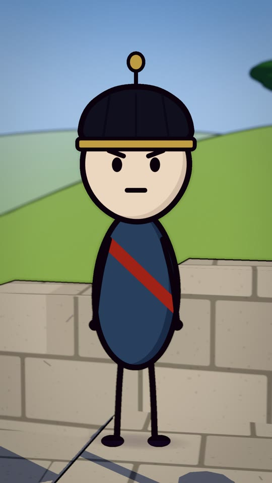
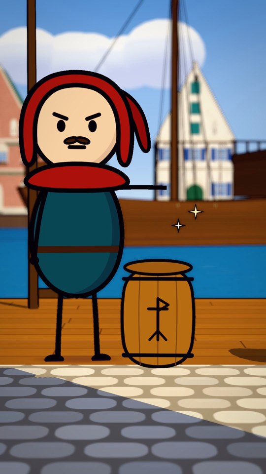
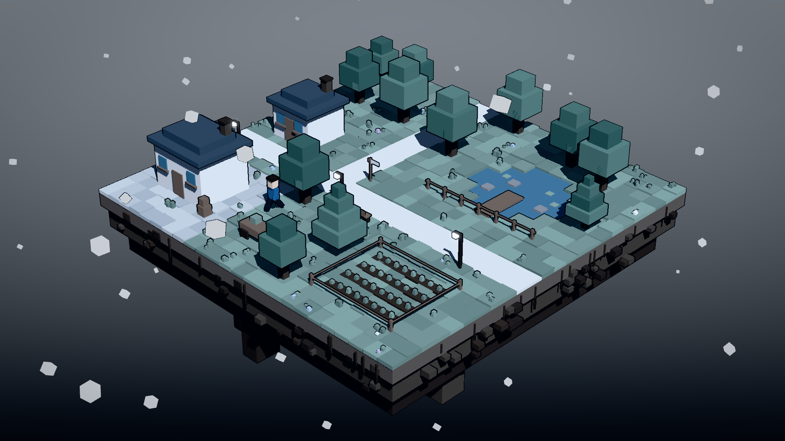

# V-Video

A home-made 3D video engine for animated history and explainer videos: Shorts (9:16) and YouTube long-form (16:9).
Everything is rendered locally with [Remotion](https://www.remotion.dev/) (React) and [three.js](https://threejs.org/).
No AI video generator is used. The engine, the styles, the music and the sound effects are all written from scratch.

<p>
  
  
  
</p>

## What's inside

| Folder | What it is |
|---|---|
| `engine/v01/` | The engine: story as data → shots, camera moves, light, ink outlines, post effects, effect cards (speech bubbles, signs, newspapers…), long-form chapters, and automated checks (flickering surfaces, objects inside each other, faces cut off, dull or dark passages) |
| `audio/v01/` | Procedural music and sound effects in Python (no samples), mixed to −22.6 LUFS; lays a recorded voice-over onto the script's timestamps |
| `styles/T0003_cartoon-3d2d/` | **Cartoon-3D2D**: flat cartoon characters (bean bodies, round heads, ink outlines) in a colourful, painted 3D world: a 1900s city, a Hanseatic port, Joseon Korea, a Viking village, ancient Rome |
| `styles/T0004_quadratic-3d/` | **Quadratic-3D**: a cold diorama of blocks; a square map floats as a rhombus in a grey void, with tiny block figures, red key words and long bowed strings |
| `.claude/skills/` | [Claude Code](https://claude.com/claude-code) skills that drive the whole production with one style each, plus a meta-skill that builds a new style from six reference images |
| `library/` | Data the Cartoon style needs: characters, cards, cameras and ready-made scene recipes (JSON) |

Comments and docs are mostly in German.

## Running it

```bash
npm install
pip install --user python-docx numpy scipy pillow
node tools/get-fonts.mjs        # free fonts (not included)
# ffmpeg is needed for muxing: set FFMPEG_DIR in .env (see .env.example)

# test stills of the Quadratic-3D template
node engine/v01/qa/stills.mjs styles/T0004_quadratic-3d/vorlage-video/index.tsx Quadratic-3D-Lang output/q_ 30,200,470 0.35
# render the Cartoon-3D2D template
npx remotion render styles/T0003_cartoon-3d2d/vorlage-video/index.tsx Vorlage-Video output/video.mp4 --codec h264 --crf 16
```

This is a showcase of a personal workflow, not a packaged library. Some files mention internal workflow documents
and tools (production guide, register, handbook) that are not part of this repository.

## License

View only, all rights reserved. See [LICENSE](LICENSE).
